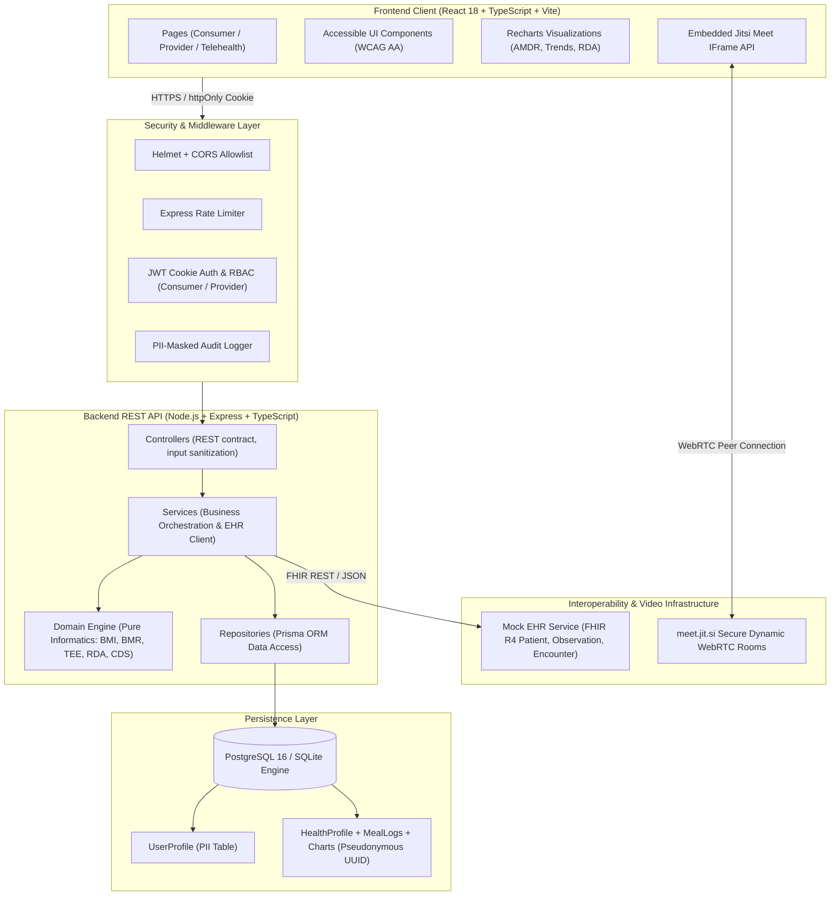

# System Architecture

The Tele-nutrition & Digital Health Platform is engineered following a clean, multi-layered architecture separating presentation, REST application logic, domain informatics, data persistence, and external health record interoperability.

## Architectural Highlights
1. **Layered Separation of Concerns**: Strict boundary: `routes -> controllers -> services -> repositories -> domain`.
2. **Pure Domain Informatics**: Clinical calculations (Mifflin-St Jeor BMR, BMI classification, Asian-Pacific cutoffs, TEE, RDA comparisons, and 10 CDS clinical rules) are implemented as deterministic, pure TypeScript functions without I/O or database dependencies, achieving 100% test coverage.
3. **Data Privacy & Pseudonymization**: PII (names, phone numbers, exact birthdates) is partitioned into a separate `UserProfile` entity, while all health metrics, meal logs, and clinical charts reference a pseudonymous UUID (`User.id`). Anonymized research exports (`/api/export/anonymized`) aggregate ages into 5-year bands and strip contact information.
4. **Resilient Interoperability**: The `ehrClient` communicates with FHIR-compliant endpoints on `mock-ehr`, providing observation pre-population for ADIME charts and pushing finalized clinical notes as FHIR `Encounter` records with timeout and error fallback mechanisms.
5. **Telehealth Video Architecture**: Uses Jitsi Meet IFrame API with dynamically generated, cryptographically unguessable room identifiers unlocked only 10 minutes prior to scheduled session time for verified session participants.
