# Entity Relationship Diagram (ERD)

The Tele-nutrition & Digital Health Platform separates Personally Identifiable Information (PII) from clinical health data using a pseudonymous UUID key, enforcing strict privacy controls, referential integrity, and domain constraints.

```mermaid
erDiagram
    User ||--o| UserProfile : "stores PII (1:1)"
    User ||--o| HealthProfile : "stores Clinical Health Data (1:1)"
    User ||--o| ProviderProfile : "stores Dietitian Credentials (1:1)"
    User ||--o{ MealLog : "logs meals (1:N)"
    User ||--o{ WeightHistory : "tracks weight changes (1:N)"
    User ||--o{ CdsAlert : "receives decision support alerts (1:N)"
    User ||--o{ Appointment : "participates in telehealth (1:N)"
    User ||--o{ AdimeChart : "associated with care plans (1:N)"
    User ||--o{ AuditLog : "audited actions (1:N)"

    MealLog ||--|{ MealFoodItem : "contains food items (1:N)"
    FoodItem ||--o{ MealFoodItem : "referenced in meals (1:N)"
    Appointment ||--o{ AdimeChart : "generates clinical chart (1:N)"

    User {
        string id PK "UUID pseudonymous identifier"
        string email UK "Authentication email"
        string passwordHash "Bcrypt hashed password"
        string role "CONSUMER | PROVIDER"
        boolean isActive "Account status"
        datetime createdAt "Audit creation timestamp"
        datetime updatedAt "Audit update timestamp"
    }

    UserProfile {
        string id PK "UUID"
        string userId FK "References User.id (PII isolation)"
        string firstName "Consumer / Provider given name"
        string lastName "Family name"
        string phone "Contact telephone number"
        datetime dateOfBirth "Exact date of birth"
        datetime createdAt "Timestamp"
        datetime updatedAt "Timestamp"
    }

    HealthProfile {
        string id PK "UUID"
        string userId FK "References User.id (Pseudonymous link)"
        string sex "MALE | FEMALE | OTHER"
        float heightCm "Height in centimeters"
        float weightKg "Weight in kilograms"
        string activityLevel "SEDENTARY | LIGHT | MODERATE | ACTIVE | VERY_ACTIVE"
        string allergies "JSON array of declared allergens"
        string medicalConditions "JSON array: DIABETES, HYPERTENSION, CKD"
        string nutritionGoals "Patient-reported dietary targets"
        boolean useAsianPacificBmi "Regional BMI cutoff flag"
        datetime createdAt "Timestamp"
        datetime updatedAt "Timestamp"
    }

    FoodItem {
        string id PK "UUID"
        string name "Verified food name (e.g. Chicken Adobo)"
        string category "Filipino Dishes | Proteins | Grains | Dairy | etc."
        float servingSize "Quantity per serving"
        string servingUnit "g | cup | piece | bowl"
        float calories "Energy (kcal)"
        float protein "Protein (g)"
        float carbs "Carbohydrates (g)"
        float fat "Fat (g)"
        float fiber "Dietary fiber (g)"
        float sodium "Sodium (mg)"
        float potassium "Potassium (mg)"
        string allergenTags "JSON array of allergen tags"
        boolean isVerified "Curated food database flag"
    }

    MealLog {
        string id PK "UUID"
        string userId FK "References User.id"
        string date "Calendar date (YYYY-MM-DD)"
        string mealType "BREAKFAST | LUNCH | DINNER | SNACK"
        string notes "Patient note"
        datetime createdAt "Timestamp"
        datetime updatedAt "Timestamp"
    }

    MealFoodItem {
        string id PK "UUID"
        string mealLogId FK "References MealLog.id"
        string foodItemId FK "References FoodItem.id"
        float servings "Number of servings consumed"
    }

    Appointment {
        string id PK "UUID"
        string consumerId FK "References User.id (Patient)"
        string providerId FK "References User.id (Dietitian)"
        datetime scheduledAt "Scheduled consultation timestamp"
        int durationMinutes "Session length in minutes (default 30)"
        string status "SCHEDULED | IN_PROGRESS | COMPLETED | CANCELLED"
        string roomName UK "Unguessable UUID session room name"
        string notes "Consultation prep notes"
        datetime createdAt "Timestamp"
        datetime updatedAt "Timestamp"
    }

    AdimeChart {
        string id PK "UUID"
        string appointmentId FK "References Appointment.id (Optional)"
        string consumerId FK "References User.id (Patient)"
        string providerId FK "References User.id (Dietitian)"
        string status "DRAFT | FINALIZED"
        string assessmentFoodNutritionHistory "eNCPT Domain 1"
        string assessmentAnthropometrics "eNCPT Domain 2 (Height, Weight, BMI, BMR, TEE)"
        string assessmentBiochemical "eNCPT Domain 3 (Lab tests: HbA1c, BP, eGFR)"
        string assessmentPhysicalFindings "eNCPT Domain 4"
        string assessmentClientHistory "eNCPT Domain 5"
        string diagnosisDomain "INTAKE | CLINICAL | BEHAVIORAL_ENVIRONMENTAL"
        string diagnosisTerm "Standardized eNCPT Diagnosis Term"
        string diagnosisEtiology "Root cause (Related to)"
        string diagnosisSignsSymptoms "Clinical evidence (As evidenced by)"
        string pesStatement "Synthesized Problem-Etiology-Signs statement"
        string interventionFoodDelivery "Prescription & diet modification"
        string interventionEducation "Nutrition education domain"
        string interventionCounseling "Nutrition counseling domain"
        string interventionCoordination "Coordination of nutrition care domain"
        string meIndicators "Monitored parameters"
        string meTargets "Measurable health goals"
        datetime meFollowUpDate "Follow-up date"
        datetime finalizedAt "Locking timestamp"
        datetime ehrExportedAt "FHIR sync timestamp"
        string ehrEncounterId "External EHR Encounter ID"
    }

    CdsAlert {
        string id PK "UUID"
        string userId FK "References User.id"
        string ruleId "Standardized CDS Rule ID"
        string severity "INFO | WARNING | CRITICAL | ALERT | FLAG"
        string message "Actionable clinical message"
        datetime triggeredAt "Detection timestamp"
        boolean dismissed "Dismissal state"
    }
```

